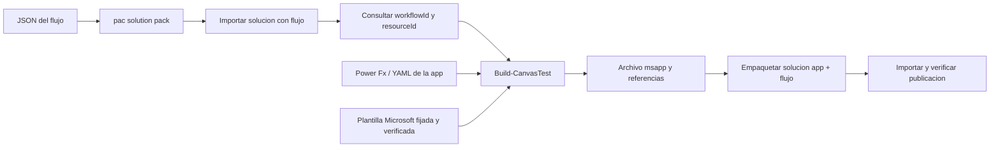
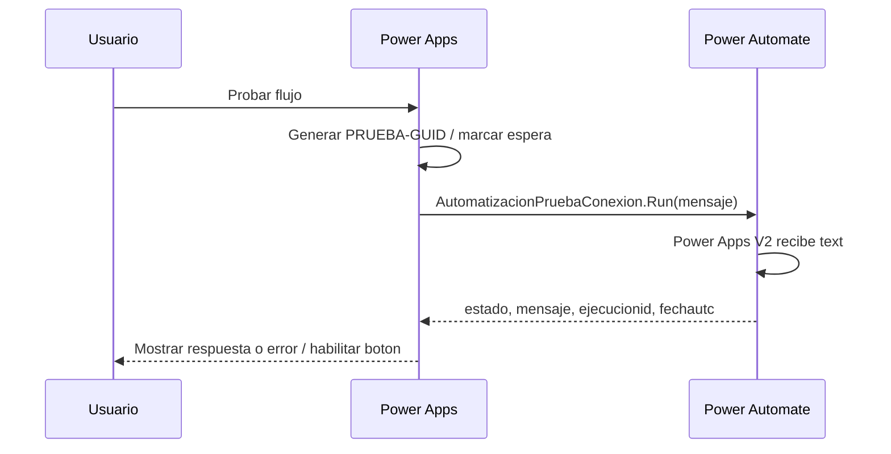

# Contexto operativo para IA

## Objetivo y estado

Construir automatizaciones desde fuentes editables con IA, empaquetarlas con
pac y verificar el resultado en Microsoft. El piloto `smoke-test` ya tiene
una app y un flujo publicados en Personal Productivity. El usuario confirmo
`OK` al ejecutar el boton y posteriormente confirmo que la app aparece en
Aplicaciones. No hay una prueba automatizada de navegador ni correlacion
independiente del ID de ejecucion.

## Construccion e interaccion son dos flujos diferentes

## Mapa de responsabilidades

| Artefacto | Responsabilidad |
| --- | --- |
| `examples/smoke-test/flow.clientdata.json` | Definicion cloud y contrato de respuesta |
| `examples/smoke-test/canvas/` | Inicializacion, boton, llamada y presentacion |
| `scripts/Build-ConnectionTest.ps1` | Workflow JSON/XML y manifest; paquete inicial |
| `scripts/Build-CanvasTest.ps1` | Resolver flujo remoto, generar app, WADL y paquete combinado |
| `scripts/Verify-ConnectionTest.ps1` | Leer publicacion y comprobar referencia app-flujo |
| `scripts/Validate-Harness.ps1` | Coherencia local de contrato, fuentes y documentos |
| `config/automations/` | Identidades y fuentes versionadas de cada automatización. |
| `config/environments/` | Plantillas de entorno; los valores locales permanecen fuera de Git. |
| `docs/automation-spec.json` | Inventario legible por maquinas y evidencia del piloto |
| `docs/TEST_RESULTS.md` | Evidencia humana y por API, con limites |

## Identidades

El nombre visible no es la clave de integracion. Las identidades estables del
piloto viven en `config/automations/smoke-test.json`; los scripts reciben una
ruta de configuracion y no fijan su GUID ni el AppId de un despliegue previo.
`Verify-ConnectionTest.ps1` resuelve la app por nombre logico si no se entrega
`-AppId`. `Build-CanvasTest.ps1` consulta el `resourceId` del flujo mediante
su `workflowId` en el entorno configurado.

## Hechos, decisiones e incertidumbres

- Observado por herramientas: pac funciona, Dataverse es accesible,
  importaciones aceptadas, ambos componentes publicados y referencias correctas.
- Confirmado por usuario: el boton devuelve OK; la app ya aparece en Aplicaciones.
- Decision del usuario: proyecto independiente y construccion apoyada en pac.
- Desconocido: causa exacta del retraso de visibilidad en Aplicaciones. Se
  sugirieron filtros/recarga, pero no se establecio causalidad.
- Sin validar: region distinta, otras cuentas, nuevos conectores, errores del
  flujo, concurrencia, reintentos y cualquier operacion financiera.

## Continuar una tarea

El orden de evolución está registrado en [FEATURE_ROADMAP.md](FEATURE_ROADMAP.md).
F01 está en curso: la configuración y la validación local ya existen; queda
probar una segunda configuración en Microsoft antes de declararla completada.

Usa [BUILD_RUNBOOK.md](BUILD_RUNBOOK.md) para construir y desplegar,
[INTERACTION_CONTRACT.md](INTERACTION_CONTRACT.md) para cambiar entradas/salidas
y [TROUBLESHOOTING.md](TROUBLESHOOTING.md) para diagnosticar sin recrear recursos.
El harness describe el camino que funciono, con sus limites; no declara que
los scripts sean un generador universal ni un pipeline de produccion.
