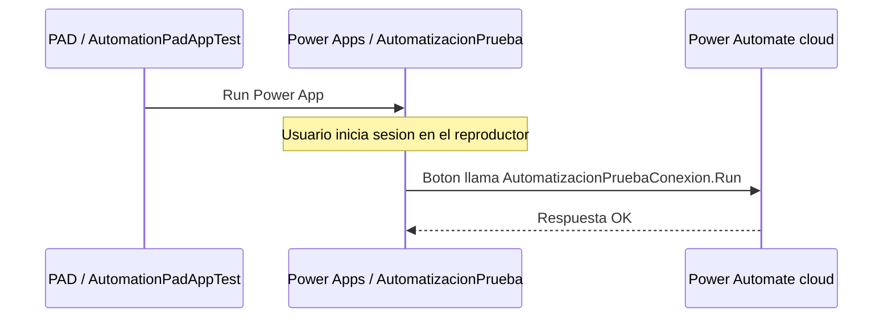

# Verificacion de Power Apps desde Power Automate Desktop

Fecha: 5 de octubre de 2026, America/Lima.
Alcance: prueba atendida solicitada por el usuario, sin operaciones financieras.

| Comprobacion | Evidencia | Resultado |
| --- | --- | --- |
| PAD instalado | Paquete Microsoft.PowerAutomateDesktop; ProductVersion del ejecutable 2.72.00183.26250 | Verificado por herramientas |
| Cuenta y entorno del diseñador | Consola PAD autenticada, Personal Productivity [PS1] | Verificado por UI Automation |
| Accion de integracion | Run Power App, AutomationId PowerPlatform.RunPowerApp | Disponible en el diseñador |
| Construccion de flujo desktop | AutomationPadAppTest creado; accion Run Power App selecciona AutomatizacionPrueba; Guardar borrador invocado | Verificado en el diseñador; no se verifico publicacion remota |
| Apertura de app desde PAD | Ejecutar abre ventana Power App del proceso PAD.RobotV2 | Verificado por herramientas |
| Autenticacion del reproductor | La ventana solicita login Microsoft; el usuario completa la sesion | Requirio interaccion del usuario |
| Carga y llamada al flujo cloud | Usuario confirma pantalla Prueba de automatizaciones y resultado OK al pulsar boton | Confirmado por el usuario |

## Que acredita esta prueba

PAD puede abrir la app existente y el usuario puede ejecutar desde ella el
flujo cloud. La sesion de pac no autentico automaticamente la ventana de
Power Apps. El diseñador pudo usarse desde el agente mediante Windows UI
Automation; esta prueba no se construyo mediante pac ni demuestra una CLI
general para authoring de PAD.

## Que sigue sin verificarse

- Crear una app nueva desde el puente de authoring de PAD. Se reutilizo la app
  canvas ya publicada, no se creo una segunda app.
- Una llamada de la app a un subflujo local mediante PowerAutomateDesktop.
  El boton actual sigue llamando al flujo cloud.
- Publicacion del flujo desktop y exportacion como componente de solucion.
  Una consulta Dataverse por nombre/categoria no devolvio registros; no tomar
  el borrador del diseñador como evidencia de publicacion remota.
- Ejecucion desatendida, otras cuentas, otras maquinas o procesos financieros.

## Siguiente prueba si se solicita ampliar el alcance

Crear un subflujo local aislado con entradas/salidas de texto. Desde Run
Power App iniciar una app nueva o abrirla por el puente Open app / Open
Designer. En Studio verificar el objeto PowerAutomateDesktop, invocar el
subflujo desde un boton y comprobar el record devuelto. Guardar/publicar y
contrastar el resultado real; no reemplazar el piloto cloud para hacerlo.

La documentacion oficial describe la creacion de una app nueva desde la
accion y requiere PAD 2.68 o posterior, Power Apps en el mismo entorno y
WebView2. Es una funcion preview de automatizacion atendida. Su disponibilidad
en la documentacion no equivale a haber completado esa creacion en esta prueba.

[Referencia oficial Run Power App](https://learn.microsoft.com/en-us/power-automate/desktop-flows/actions-reference/power-platform).
